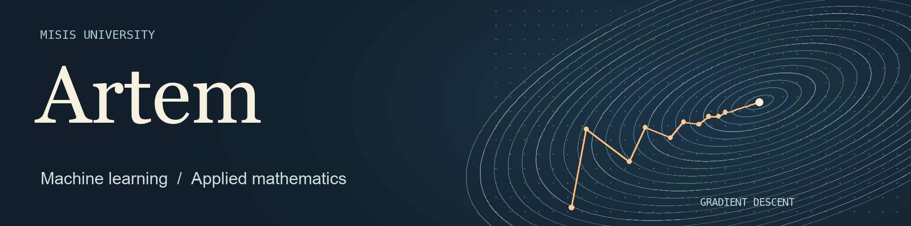

I'm Artem, a **Computer Science and Engineering** student at **MISIS University**. I like taking a formula apart on paper and rebuilding it in Python. Right now I'm working through gradient descent and regularization, alongside SQL on real datasets.

## Hackathons

### 🥈 SaluteAgent · ShortHack
**2nd place · Sber hackathon, SberTech challenge**

Our team built a support assistant that searches a knowledge base, cites the instructions behind each answer, and checks whether those sources support its claims. If a claim still fails verification after a rewrite, a human operator gets the ticket. [Explore SaluteAgent →](https://github.com/nighttcrawlerr/ShortHack)

### Ostrovok Hackathon · Hotel search
**Geospatial engineering · Team MISIS Who Is OS**

Can a guest actually see the sea from their room? I worked on the calculations behind that question, using building footprints, floor levels, and façade orientation to estimate sea views and sunlight. Each estimate carries its source and confidence level. [Team repository →](https://github.com/ostrovok-hackathon-2026/misis-who-is-os)

## Selected work

| Project | Inside |
| :-- | :-- |
| [**Trajectory** ↗](https://artemidiy777.github.io/way_to_money/) | An interactive ML study guide with a dependency-aware roadmap, math exercises, SQL practice, and an offline edition. [Source](https://github.com/Artemidiy777/way_to_money) |
| [**Machine Learning Notebooks** ↗](https://github.com/Artemidiy777/FPMI_ML) | My work through the Deep Learning School course, including linear regression in NumPy and experiments with gradient descent and regularization. |
| [**Python Labs** ↗](https://github.com/Artemidiy777/python_labs) | University coursework spanning text-processing CLIs, file conversion, sorting benchmarks, and linked data structures. |

## Tools I use and explore

  
  
  
  
  
  

