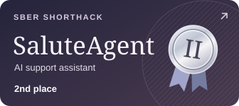

**Machine learning** · Computer Science and Engineering student at MISIS University.

### Hackathons

### Selected projects

[ML Notebooks](https://github.com/Artemidiy777/FPMI_ML) · [Trajectory](https://artemidiy777.github.io/way_to_money/) · [Python Labs](https://github.com/Artemidiy777/python_labs)

### Toolbox

   

     
